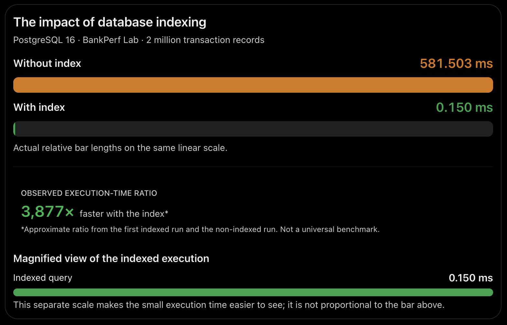

## The curiosity behind the experiment

I've always found database performance interesting.

It's one thing to understand database concepts theoretically. It's another to observe what actually happens when a database has to process millions of records.

Recently, I decided to explore this more practically through a personal project i'm building called **BankPerf Lab**.

The idea is simple: build a controlled environment where i can experiment with database engineering, performance testing, optimisation and other aspects of systems engineering.

For my first investigation, i wanted to answer a seemingly straightforward question:

*How much difference can a database index actually make?*

---

## The problem

Imagine a banking application retrieving the most recent transactions associated with a customer's account.

As transaction volumes grow, finding a relatively small number of records within a large transaction table can become expensive, especially when the database has to examine a substantial portion of the table to locate them.

For this experiment, i created a PostgreSQL database containing approximately 2.35 million synthetic records across six tables.

The `transactions` table alone contained **2 million records**.

My hypothesis was that a composite B-tree index on `(account_id, created_at DESC)` would significantly reduce the execution time of an account transaction-history query.

---

## Inside BankPerf Lab

The environment runs locally on my Apple MacBook Pro M4, using Docker Compose and PostgreSQL 16.16.

The dataset represents a simplified banking environment, with records covering:

- Branches
- Customers
- Transaction channels
- Accounts
- Transactions
- Audit logs

I created the following composite index:

```sql
CREATE INDEX idx_transactions_account_created
ON transactions (account_id, created_at DESC);
```

The intention was to support two operations simultaneously: filtering transactions by account and retrieving them in descending chronological order.

---

## Putting the hypothesis to the test**

I used the following query to retrieve the 20 most recent transactions for a particular account:

```sql
SELECT
    transaction_id,
    transaction_ref,
    transaction_type,
    amount,
    status,
    created_at
FROM transactions
WHERE account_id = 25025
ORDER BY created_at DESC
LIMIT 20;
```

I executed the query using PostgreSQL's `EXPLAIN (ANALYZE, BUFFERS)` to inspect its execution plan and performance statistics.

I tested two conditions:

1. With the composite index available.
2. With the index temporarily removed.

For the second condition, i dropped the index inside a database transaction and rolled back afterwards, which restored the original database state.

Same query. Same dataset. Different index availability.

---

## Then came the results...


<!-- 

 -->


*Figure 1: Observed execution time with and without the composite B-tree index.*

The difference was quite interesting.

| Execution condition | Execution time |
|---|---:|
| With index | 0.150 ms |
| Without index | 581.503 ms |

The first indexed execution completed in **0.150 milliseconds**, while the non-indexed execution took **581.503 milliseconds**.

That's an observed execution-time ratio of approximately **3,877×**.

But the interesting part wasn't just the execution time.

PostgreSQL selected entirely different execution plans.

With the index, it used an `Index Scan`. The composite index supported both the account filter and the requested ordering, so no separate sorting operation was required.

Without the index, PostgreSQL used a `Parallel Sequential Scan`, followed by a `Sort` and `Gather Merge`.

It launched two parallel workers and examined a substantial portion of the transaction table to find just 13 matching records.

The buffer statistics told a similar story:

| Measurement | With index | Without index |
|---|---:|---:|
| Shared buffer hits | 19 | 3,883 |
| Shared buffer reads | 0 reported | 34,617 |

I also inspected the physical B-tree structure using PostgreSQL's `pgstatindex()` function.

The index occupied approximately 60 MB and had three tree levels, 7,663 leaf pages and an average leaf density of 90.03%.

It was interesting to move beyond simply observing that the query was faster and actually examine the structure responsible for supporting that execution.

---

## The trade-offs and a few lessons

Of course, indexes aren't free.

They consume storage and introduce additional maintenance overhead when records are inserted, updated or deleted.

Creating indexes indiscriminately can therefore increase storage requirements and affect write performance.

There's also an important qualification to my results.

This was an initial experiment, not a statistically controlled benchmark. I performed two indexed executions and one non-indexed execution, without standardising the buffer-cache state between the tests.

The indexed executions reported no shared buffer reads, whereas the non-indexed execution reported 34,617.

Consequently, the approximately 3,877× difference should be treated as an observation from this experiment, not a universal performance guarantee.

A more comprehensive investigation would involve repeated executions, controlled cache conditions, different transaction volumes and concurrent workloads.

My biggest takeaway?

**Database optimisation should be evidence-driven.**

Understanding indexes theoretically is useful, but examining execution plans, buffer activity and physical index statistics gives you a much deeper understanding of why a query behaves the way it does.

---

## What's next?

This is the first investigation in the BankPerf Lab series.

I'm looking forward to exploring more areas of database engineering and performance optimisation, and into the internal mechanisms that influence how systems behave.

More experiments, more questions, and hopefully a few more interesting discoveries along the way.

For now, one thing is clear: sometimes the best way to understand a database is to make it work, observe what happens, and investigate why.